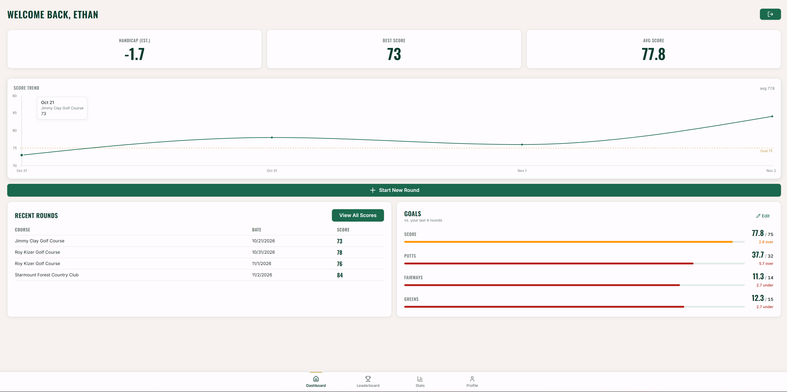
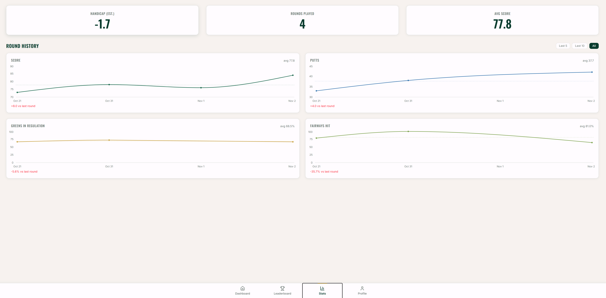
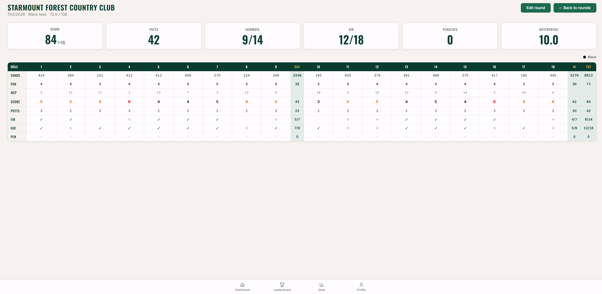

# Albatross

A full-stack golf statistics tracker for logging rounds and tracking stats over time.

I built Albatross to show I understand full-stack fundamentals, and to build something I'd actually use. I'm an avid golfer, and most golf stat apps are either bloated or locked behind steep paywalls. Albatross keeps it simple: log a round, quickly or hole by hole, and track the stats that matter.

## Design decisions

### Working within the course API's limits

Detailed course data (pars, yardages, tees, slope and course ratings) comes from the ryzegolf API on RapidAPI. It's the only affordable source I found, but it's built for lookups, not search:

- 10,000 objects per day on my plan, and failed calls still count against it
- Search returns at most 10 courses and only matches on name
- Course IDs are encrypted, so there's no way to build a course list from it

Calling it on every keystroke for typeahead search would have burned through the quota fast and still given poor results.

**The fix: split search from lookup.**

- **Search runs on open data.** I pulled 12,598 US golf course names from OpenStreetMap into a static JSON file. Typeahead filters that list in the browser, so typing costs zero API calls.
- **The API is only called once a course is picked**, and the result is cached in Postgres. Each course is fetched from ryzegolf once, then served from the database to every user after that.
- **Rate limits are a backstop:** 20 lookups per user per 15 minutes, plus a global daily cap set well under the quota.

The result is that API usage scales with the number of *new courses* people play, not with the number of users or searches.

**Stack**
- Frontend: React 19 + Vite, react-router-dom, Tailwind v4, lucide-react, recharts. Source in src/, components in src/components
- Backend: Node (>=22) + Express 5, entry point golf_backend/server.js. Routes in golf_backend/src/routes (auth, courses, rounds, profiles, targets), middleware in golf_backend/src/routes/middleware (auth.js, rateLimit.js)
- Database: PostgreSQL via pg, database name golf_backend. Schema lives in golf_backend/src/db/schema.sql. Use that as the source of truth for the schema section

**Features**
- Auth: /register and /login, bcrypt-hashed passwords, JWT tokens, rate limiting via express-rate-limit
- Course search: course name list from OpenStreetMap (utils/osmCourses.js) for typeahead, plus detailed course data from the ryzegolf API on RapidAPI, cached server-side
- Round logging: quick-log form, or hole-by-hole entry that fills in a generated scorecard. Rounds can be edited after saving
- Handicap calculation: logic in golf_backend/src/utils/handicap.js, plus a recalc script in golf_backend/src/scripts/recalc-handicaps.js. 
- Stats and trends: stat charts built with recharts (Stats.jsx, Statcharts.jsx)
- Goals: per-user targets for score, putts, fairways, and greens (defaults 90/36/9/9 on register)
- Leaderboard and user profiles (Leaderboard.jsx, routes/profiles.js). 
- calculates handicap by using slopes/ratings of selected course/tees.
- Differential = (113/ Slope Rating) * (Gross Score - Course Rating)
- Handicap would take a portion of your lowest/best differentials and average them. For example, if you have more than 20 rounds it will take your most recent 20 and average the best 8 differentials. 
- Stats and trends: stat charts built with recharts (Stats.jsx, Statcharts.jsx)

**Scripts (from root package.json)**
- npm run dev: Vite dev server
- npm run build: production frontend build
- npm start: runs the Express backend
- npm run lint: ESLint
- npm test: backend tests

**Testing**
- Automated backend tests using Node's built-in test runner (node:test) with Supertest
- npm test runs golf_backend/test/*.test.js serially (--test-concurrency=1)
- Suites: auth, cache, handicap, rateLimit, with shared helpers.js and env.js. Uses a seperate db to cross check back end.
- No frontend tests

**Deployment**
- Deployed on Railway from GitHub.

## Roadmap

-[x] Round Logging, edit rounds
-[x] Handicap Calculation
-[x] Track GIR, Fairways, Pens, and Scores
-[x] Leaderboard tracks users
-[] Add pages to view rounds when rounds > 20
-[] Display notes underneath view scorecards
-[] mobile optimization
-[] Handicap trends, score trends on par 3/5s, average penalties a round.
-[] Implement a challenge mode where users can compete with eachother in different game modes, skins, wolf, match play, gross/net, etc.
-[] AI insights to what users can do to improve their scores, should they focus on putting? off the Tee? scoring on par 3's? avoiding penalties?

Link: https://albatross-production-f0e0.up.railway.app

**Use Demo Mode to get a preview of how the app works **

